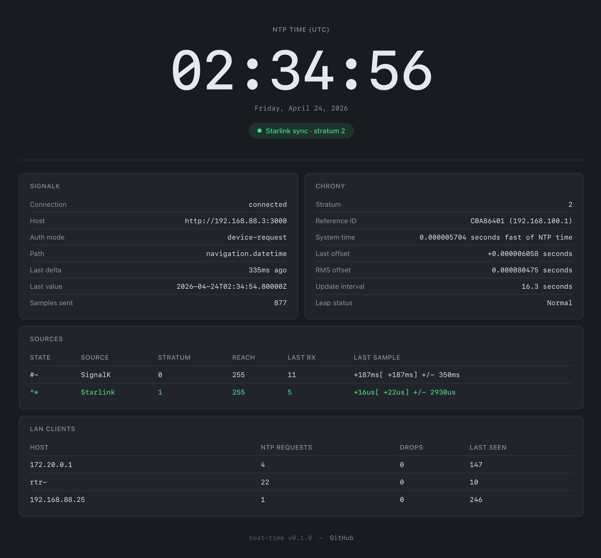

# seaTime

Dockerized NTP server that sources time datum from SignalK, Starlink, a USB GPS puck, NMEA 0183 over TCP, or NMEA 2000 over CAN




## Why

If you're on a boat with a GPS on NMEA 2000 feeding a SignalK server, you
already have a GPS-disciplined time source. This project turns it into a real
LAN NTP server — so every device on your boat network stays in sync with UTC,
even when you're away from the internet for weeks.

Runs alongside SignalK as a separate container, so SignalK restarts or upgrades
don't affect your LAN's time service.

## Architecture

```
SignalK server ──WebSocket──┐           seaTime
                            │        ┌──────────────────────────┐
USB GPS puck ──NMEA/serial──┤        │ Python bridge            │
                            │        │  ├─ subscribes SignalK   │
NMEA 0183 ──TCP─────────────┤        │  ├─ reads USB GPS NMEA   │
 (gateway, mux...)          │        │  ├─ reads NMEA over TCP  │
NMEA 2000 ──SocketCAN───────┤        │  ├─ reads N2K off can0   │
 (can0)                     │        │  ├─ feeds chrony SOCKs   │
Starlink dish ──NTP─────────┼──────► │  └─ serves web UI :8123  │
 (192.168.100.1)            │        │           │              │
Optional pool ──NTP─────────┘        │           │              │
                                     │           ▼              │
                                     │    chronyd               │
                                     │     ├─ refclock (SIGK)   │
                                     │     ├─ refclock (USB)    │
                                     │     ├─ refclock (NTCP)   │
                                     │     ├─ refclock (NCAN)   │
                                     │     ├─ server (Starlink) │
                                     │     ├─ optional pool     │
                                     │     └─ serves UDP/123    │
                                     └──────────────────────────┘
                                               │
                                               ▼
                                         LAN NTP clients
```

## Ports

| Port | Protocol | Purpose |
|---|---|---|
| 123 | UDP | NTP (LAN clients) |
| 8123 | TCP | Web UI + JSON status API |

## Quick start

```bash
git clone https://github.com/ofernander/seaTime.git
cd seaTime
cp .env.example .env
# edit .env — at minimum set NTP_ALLOW_SUBNETS and one time source
# (SIGNALK_URL, USB_GPS_DEVICE, NMEA_TCP_HOST, N2K_CAN_INTERFACE, or STARLINK_NTP_IP)
docker compose up -d
docker compose logs -f
```

Open `http://<host>:8123/` for the status page. From any LAN client:

```bash
sntp -d <host>
# or
chronyc -h <host> tracking
```

## SignalK

Set `SIGNALK_URL` in `.env` to your SignalK server's reachable address — a LAN
IP or hostname works in all cases:

```
SIGNALK_URL=http://signalk-ip/hostname:3000
```

**Optional shortcut** for same-host deployments: add
`extra_hosts: ["host.docker.internal:host-gateway"]` to `docker-compose.yml`,
then use `SIGNALK_URL=http://host.docker.internal:3000`. Saves you from
looking up the host's LAN IP.

## USB GPS puck

Any USB GPS receiver that speaks NMEA 0183 works — u-blox 7/8 pucks
(VK-162, VK-172, GT-U7), GlobalSat BU-353, and similar. The bridge reads
`RMC` sentences, and for each valid fix it sends that fix's UTC time to chrony
as the `USB` refclock.

1. Plug the puck into the Docker host and find its stable path:

   ```bash
   ls -l /dev/serial/by-id/
   ```

2. Pass it through in `docker-compose.yml`, mapping it to `/dev/gps0` inside
   the container:

   ```yaml
   devices:
     - /dev/serial/by-id/usb-u-blox_AG_-_www.u-blox.com_u-blox_7_-_GPS_GNSS_Receiver-if00:/dev/gps0
   ```

3. Set `USB_GPS_DEVICE=/dev/gps0` in `.env` and `docker compose up -d`.

The baud rate is auto-detected unless `USB_GPS_BAUD` is set. The puck needs
sky view to get a fix. Until it has one, the web UI shows **no fix** and no
samples are sent.

**Accuracy.** USB pucks don't expose a PPS signal, so time comes from when
each NMEA sentence arrives. That arrival lags the top of the second by a
fairly constant amount (typically 50–200ms). To calibrate it, run with
Starlink or the pool also enabled and let chrony settle for a few minutes.
Then set `USB_GPS_OFFSET` to the USB GPS source's typical **Last sample**
offset in the Sources table (e.g. `+118ms` → `USB_GPS_OFFSET=0.118`).
Calibrated, expect roughly 10–50ms — better than SignalK, worse than
Starlink.

**Hot-plug.** The bridge reconnects automatically if the puck is unplugged
and replugged. Docker's `devices:` mapping is fixed when the container is
created, so if the host enumerates the puck as a different node after
replugging, restart the container.

## NMEA 0183 over TCP

Many marine devices serve NMEA 0183 sentences on a TCP port: NMEA 2000 /
0183 Ethernet and WiFi gateways (Yacht Devices, Actisense, Digital Yacht,
Quark-elec...), multiplexers, and SignalK's own NMEA 0183 server. If one of
them carries sentences from your installed GPS, seaTime can take time from
it directly, with no SignalK WebSocket hop and no separate USB puck.

1. On the device, enable a **TCP** server that outputs NMEA 0183 and note
   its port.
2. Set `NMEA_TCP_HOST` and `NMEA_TCP_PORT` in `.env` and `docker compose up -d`.

The bridge connects as a TCP client and reads `RMC` sentences for time and
`GGA` for the satellite count, from any talker. Everything else on the
stream (depth, wind, AIS...) is ignored. It reconnects automatically if the
connection drops or goes quiet.

UDP isn't supported. Devices that "serve" UDP usually broadcast it, and
broadcasts don't reliably reach a container on Docker's bridge network.

**Accuracy.** Time comes from when each sentence arrives, after it has passed
through the serving device and the network, with no PPS. Calibrate
`NMEA_TCP_OFFSET` the same way as `USB_GPS_OFFSET` (see above), using the
NMEA 0183 (TCP) source's **Last sample** offset.

## NMEA 2000 over CAN

With a SocketCAN adapter (a USB-CAN adapter or CAN hat that shows up on the
host as `can0`), seaTime reads time straight off the NMEA 2000 bus. It uses
PGN 126992 (System Time) from your GPS, with no gateway, conversion or network
in between.

- A kernel filter delivers only PGN 126992 frames to seaTime.
- Each frame is timestamped by the kernel as it arrives.
- Only time marked as GPS or GLONASS is used, so a chartplotter echoing its
  own clock onto the bus is ignored.
- seaTime never transmits onto the bus.
- SocketCAN gives every frame to every reader, so SignalK can use the same
  interface at the same time.

**Requirements**

- **Host networking.** CAN interfaces are network interfaces, so the
  container only sees `can0` with `network_mode: host`.
- **The host brings the interface up.** NMEA 2000 runs at 250 kbit/s. With
  systemd-networkd, which also re-applies it if a USB adapter is replugged,
  create `/etc/systemd/network/80-can0.network`:

  ```ini
  [Match]
  Name=can0

  [CAN]
  BitRate=250K
  ```

  Then `sudo systemctl enable --now systemd-networkd`. networkd only manages
  interfaces matched by a `.network` file, so this doesn't touch your other
  interfaces. To bring it up by hand instead:

  ```bash
  sudo ip link set can0 up type can bitrate 250000
  ```

**Setup:** set `N2K_CAN_INTERFACE=can0` in `.env` and `docker compose up -d`.
If more than one device on the bus sends GPS time, the card shows which bus
address is being used, and `N2K_CAN_SOURCE` can pin it to one.

**Accuracy.** There's no PPS, so the GPS's own delay in sending 126992 still
applies. Calibrate `N2K_CAN_OFFSET` the same way as `USB_GPS_OFFSET` (see
above). With no gateway or network in the path, expect less jitter than the
NMEA 0183 sources.

## SignalK authentication

The bridge supports three ways to authenticate to SignalK. Pick whichever
matches your SignalK security settings:

1. **No auth / readonly access** — leave all auth env vars blank. Works when
   SignalK has "Allow Readonly Access" enabled, or security is disabled. On
   startup the bridge probes the configured path with a plain HTTP GET; if it
   gets a 200, it proceeds without auth.

2. **Username/password** — set `SIGNALK_USERNAME` + `SIGNALK_PASSWORD`. Bridge
   logs in at startup, gets a token, uses it for the WebSocket.

3. **Device access request** — if the probe returns 401/403 and no
   username/password is set, the web UI shows a **Request SignalK access**
   button. Click it, approve the request in SignalK's admin UI (Security →
   Access Requests), and the bridge picks up the new token and reconnects.
   Token is persisted to `/data/signalk-token` so subsequent starts don't
   need re-approval.

   For unattended deployments you can pre-trigger the flow by setting
   `SIGNALK_REQUEST_ACCESS=true` in `.env` — the bridge will post the access
   request at startup and wait for approval.

## Setting the host clock (optional)

There are two ways to get the Docker host's own clock synced to seaTime.
Pick one, not both.

**Approach A: Let the host's existing NTP client point at seaTime** (recommended).

The host's existing NTP client (usually `systemd-timesyncd` on Debian/Ubuntu)
queries seaTime on `127.0.0.1:123` like any other LAN client. Cleanest
separation — the container stays unprivileged relative to the host clock.

```bash
# Edit /etc/systemd/timesyncd.conf on the host:
#   NTP=127.0.0.1
#   FallbackNTP=pool.ntp.org   # optional — used if container is down
sudo systemctl restart systemd-timesyncd

# Verify:
timedatectl timesync-status
# Should show: Server: 127.0.0.1 (127.0.0.1), Stratum: 2+, Packet count: 1+
```

**Approach B: Let the container discipline the host clock directly.**

Set `SET_HOST_CLOCK=true` in `.env`. The container uses its `CAP_SYS_TIME`
capability to step/slew the host's kernel clock directly. You MUST disable
the host's own NTP client first, or two things will fight over the clock:

```bash
sudo systemctl disable --now systemd-timesyncd
```

Default (`SET_HOST_CLOCK=false`) means the container serves NTP to the
LAN but doesn't touch the host clock — suitable for Approach A or for hosts
that don't need their clock disciplined by seaTime at all.

## Env vars

See `.env.example` for the full annotated list. The essentials:

| Variable | Default | Purpose |
|---|---|---|
| `SIGNALK_URL` | (blank) | SignalK server URL, e.g. `http://192.168.1.50:3000`. Blank = SignalK source disabled |
| `SIGNALK_PATH` | `navigation.datetime` | SignalK path providing GPS datetime |
| `SIGNALK_USERNAME` | (blank) | Optional. Pair with `SIGNALK_PASSWORD` for password auth |
| `SIGNALK_PASSWORD` | (blank) | Optional. Pair with `SIGNALK_USERNAME` for password auth |
| `SIGNALK_REQUEST_ACCESS` | `false` | Optional. Set to `true` to auto-trigger the device access request flow at startup. Mutually exclusive with `SIGNALK_USERNAME`/`SIGNALK_PASSWORD` |
| `NTP_ALLOW_SUBNETS` | `192.168.0.0/16,10.0.0.0/8` | CIDRs allowed to query NTP |
| `NTP_FALLBACK_POOL` | `pool.ntp.org` | Pool used when GPS is unavailable. Blank = disabled |
| `USB_GPS_DEVICE` | (blank) | Path inside the container to a USB GPS puck, e.g. `/dev/gps0`. Blank = disabled |
| `USB_GPS_BAUD` | (auto) | Serial baud rate. Blank = auto-detect (9600, 4800, 38400, 115200) |
| `USB_GPS_OFFSET` | `0` | Seconds of NMEA arrival delay to subtract. See [USB GPS puck](#usb-gps-puck) |
| `NMEA_TCP_HOST` | (blank) | IP/hostname of a device serving NMEA 0183 over TCP. Blank = disabled |
| `NMEA_TCP_PORT` | (blank) | Its TCP port. Required with `NMEA_TCP_HOST` |
| `NMEA_TCP_OFFSET` | `0` | Seconds of delivery delay to subtract. See [NMEA 0183 over TCP](#nmea-0183-over-tcp) |
| `N2K_CAN_INTERFACE` | (blank) | SocketCAN interface carrying NMEA 2000, e.g. `can0`. Needs host networking. Blank = disabled |
| `N2K_CAN_OFFSET` | `0` | Seconds of GPS send delay to subtract. See [NMEA 2000 over CAN](#nmea-2000-over-can) |
| `N2K_CAN_SOURCE` | (blank) | Only accept time from this bus address (decimal or `0x` hex). Blank = any GPS |
| `STARLINK_NTP_IP` | (blank) | Starlink dish IP (`192.168.100.1`) to use its stratum-1 NTP server |
| `SET_HOST_CLOCK` | `false` | Let chrony discipline the host clock |
| `HOST_TZ_FILE` | `/etc/timezone` | Path inside the container to a file with the host's IANA zone. Bind-mounted from the host in `docker-compose.yml` |
| `LOG_LEVEL` | `INFO` | Python logging level |

## Time sources

The container can pull time from these sources:

**NTP Pools** - Traditional NTP pools from the internet set with `NTP_FALLBACK_POOL` default is `pool.ntp.org`

**SignalK** - Subscribes to `navigation.datetime` on your SignalK server over WebSocket.

**Starlink** - Starlink user terminals run a stratum-1
NTP server on their LAN (port 123, typically `192.168.100.1`). Enabled by setting `STARLINK_NTP_IP` in `.env`.

**USB GPS puck** - Reads NMEA directly from a USB GPS receiver passed through to the container. Enabled by setting `USB_GPS_DEVICE` in `.env`. See [USB GPS puck](#usb-gps-puck).

**NMEA 0183 over TCP** - Reads GPS time from any device serving NMEA 0183 on a TCP port (gateways, multiplexers, SignalK). Enabled by setting `NMEA_TCP_HOST`/`NMEA_TCP_PORT` in `.env`. See [NMEA 0183 over TCP](#nmea-0183-over-tcp).

**NMEA 2000 over CAN** - Reads PGN 126992 System Time from your GPS straight off the bus through a SocketCAN adapter. Enabled by setting `N2K_CAN_INTERFACE` in `.env`. See [NMEA 2000 over CAN](#nmea-2000-over-can).

**NEMA2K via CAN adapter in the works**


## Web UI

`http://<host>:8123/` shows a live status page:


## Status API

`GET /api/status` returns a JSON snapshot for scripting:

```json
{
  "signalk": {
    "url": "...", "connected": true, "auth_mode": "device-request",
    "needs_access": false, "last_datetime_value": "...", "is_stale": false,
    "access_request": { "state": "idle", "approve_url": null, "error": null }
  },
  "chrony_socket": { "samples_sent": 1234, "last_sample_offset_seconds": -0.001 },
  "usb_gps": {
    "enabled": true, "device": "/dev/gps0", "baud": 9600, "connected": true,
    "has_fix": true, "satellites": 9, "last_datetime_value": "...",
    "is_stale": false, "samples_sent": 567, "last_error": null
  },
  "nmea_tcp": {
    "enabled": true, "host": "192.168.88.10", "port": 10110,
    "connected": true, "has_fix": true, "satellites": 11, ...
  },
  "n2k_can": {
    "enabled": true, "interface": "can0", "source_filter": null,
    "gps_address": 2, "time_source": "GPS", "connected": true, "has_fix": true, ...
  },
  "chrony": {
    "tracking": { ... }, "sources": [...], "ntpdata": { ... }, "clients": [...]
  },
  "uptime_seconds": 42.0
}
```

## Troubleshooting

- **Container logs:** `docker compose logs -f`
- **chrony tracking:** `docker exec seatime chronyc tracking`
- **chrony sources:** `docker exec seatime chronyc sources -v`
- **LAN clients:** `docker exec seatime chronyc clients`

**SignalK source shows `^x` (falseticker):** expected when Starlink or pool
are reachable — SignalK's WebSocket-delivered time has ~100-200ms systematic
bias, and chrony correctly flags it a falseticker when more accurate sources
disagree. SignalK will still be used as a fallback when the others go away.

**UI shows "chrony unsynced · no working sources":** chrony hasn't committed
to a source yet. Wait 1–2 minutes after container start while reach climbs.

**USB GPS shows "disconnected" / "no NMEA data":** check the device is passed
through (`docker exec seatime ls -l /dev/gps0`) and that nothing on the host
is holding it open. `gpsd` and `ModemManager` both like to grab USB serial
devices: `sudo systemctl disable --now gpsd.socket gpsd ModemManager`.

**NMEA 0183 (TCP) card shows "connected" but "waiting for RMC…":** the
server is up but isn't sending `RMC` sentences. Check that the device outputs
NMEA 0183 (not a proprietary or NMEA 2000 raw format) on that port, and that
any output filters on it let `RMC` through.

**NMEA 2000 (CAN) card shows "interface down":** check the host has the
interface up (`ip -details link show can0` should say `UP` and
`bitrate 250000`), and that the container uses host networking.

**NMEA 2000 (CAN) card shows "waiting for PGN 126992…":** no GPS time is
arriving. Watch for it on the host with can-utils:
`candump can0,01F01000:03FFFF00`. If frames appear but the card still waits,
check the container log for `ignoring PGN 126992 from address N`: the only
sender isn't marking its time as GPS/GLONASS. If nothing appears, the GPS
isn't sending 126992. Some GPS units only send it when enabled in their
settings or on the MFD.

**USB GPS reports "implausible date (GPS week rollover?)":** older pucks with
SiRF III chipsets report dates ~19.6 years in the past since the 2019 GPS
week rollover. The receiver needs a firmware update or replacing.

**Bridge shows `auth_failed` / access-request button doesn't disappear after
approval:** check that `/data/signalk-token` was written inside the container.
The next WebSocket reconnect picks up the new token automatically (no restart
needed).

## License

GPL-3.0
